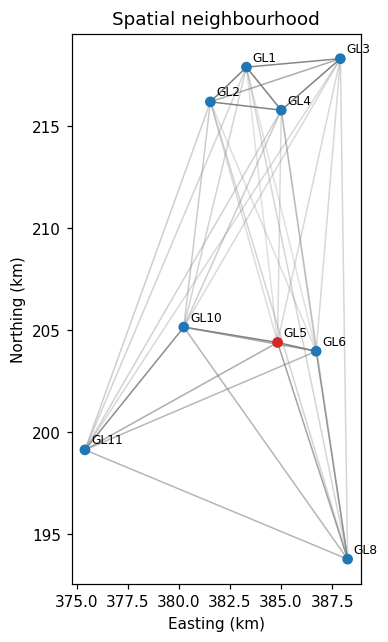

# housing-star

> **Purpose and limitations**
>
> This project is a research and teaching tool for exploring house-price forecasting.
>
> Forecasting a market as complex as residential property is inherently reductive. These models use historical price movements and relationships between neighbouring areas. They do not explicitly account for interest rates, mortgage availability, household incomes, housing supply, policy changes or the many other factors that influence prices. Historical relationships can change, and unexpected events can overwhelm them. Forecast accuracy should therefore be treated as an empirical question, not an expectation: fitting past data well does not mean a model will forecast future prices well.
>
> The outputs are **point forecasts of area-level sold prices** (medians by default, or a composition-adjusted index), not valuations of individual properties. Property types are pooled and new builds are excluded. Changes in which properties sell can move the median even when underlying property values have not changed; the [adjusted index](#composition-adjusted-prices) holds the mix of streets and property types fixed, but not size or condition. The models provide no prediction intervals, and estimates based on short histories can be noisy or unstable. Scenarios describe how a fitted model responds to an assumed shock; they do not establish causation or predict what will happen.
>
> The examples and evaluation results illustrate the methods on particular places and periods. They do not establish that the models will perform similarly elsewhere or in future market conditions. Use the outputs to investigate patterns and test hypotheses, **not as a basis for financial or property decisions**. They are not financial advice or professional valuations.
>
> The project relies on third-party data that may be incomplete, delayed or revised. Cached data are not refreshed automatically, and preparation choices—including aggregation, interpolation and spatial weights—affect the results. Check the data and assumptions behind any analysis, and consult [ATTRIBUTION.md](ATTRIBUTION.md) for data sources and licensing information.
>
> The software is released under the [MIT licence](LICENSE) and is provided **as is**, without warranty.


Spatial-temporal autoregression (STAR) for England and Wales house prices: model a postcode **together with its
neighbours**, test it against simpler forecasts, and explore what the fitted model implies if a
neighbouring area's prices move.

- **Data pipeline** from HM Land Registry sales to a model-ready, spatially weighted panel.
- `StarModel`, plus `ArModel` (per-postcode AR(p)), `DriftModel` (average growth from the latest price) and `NoChangeModel` (the latest price carried forward) benchmarks, all with the
same `fit` / `predict` / `forecast` interface.
- **Mostly analytical estimation**: only the spatial parameter `ρ` is numerically optimised; conditional on `ρ`, the remaining coefficients are fitted by ordinary least squares and the innovation variance is calculated directly from the residuals.
- **Walk-forward cross-validation**, a grid-search `tune`, and out-of-sample `evaluate` under one-step and recursive protocols.
- **Scenario engine**: shock one or more postcodes (`clamp` or `impulse`) and read off the response the fitted model implies (a statistical association, not a causal effect).
- **Results are tables**: every result is a polars DataFrame by default, or pandas with `as_pandas=True`.
- **Managed data**: Land Registry sales are downloaded and cached for you (first run is slow, see below).
- **Your own panel**: `PriceSeriesDataset.from_panel` fits the same models on a polars DataFrame
the pipeline has already prepared.
- Typed (`py.typed`), polars-first (pandas is never imported; only an optional export), 100% test coverage.


## Quickstart

**England and Wales only.** Prices are HM Land Registry Price Paid Data. Scotland, Northern
Ireland, and the Crown Dependencies are not in that register: the build stops with
`No transactions found ... England and Wales only`. Ask for a district (`GL5`) or a sector
(`GL5 1`). A full unit postcode such as `GL5 2AD` is rejected.

```python
import housing_star as hs
import polars as pl

##########################################################################
# Forecast sold prices in a target postcode considering the price history
# of adjoining postcodes
##########################################################################

ds = hs.PriceSeriesDataset.from_postcode(
    "GL5",
    start="2005-01-01",
    end="2016-01-01",  # exclusive: observations through 2015
    freq="1y",
    holdout=0,  # use all observations to fit the forecast
    graph=hs.GraphConfig(radius_m=15_000, max_nodes=20),
)

# 1. Fit STAR and generate forecasts using housing_star.
model = hs.StarModel(p=1).fit(ds)
forecasts = model.forecast_frame(ds, horizon=3)

# The package returns a Polars DataFrame for every node.
# Columns: postcode, step (1–3), forecast (price in pounds).
print(forecasts)

# 2. Optional: use Polars to present just the target district.
# Cleaning can merge districts, so use the effective target label.
target = ds.postcodes[ds.target_idx]
last_year = int(ds.times[-1][:4])
last_price = ds.prices[ds.target_idx, -1]

target_forecast = forecasts.filter(pl.col("postcode") == target).select(
    (pl.lit(last_year) + pl.col("step")).alias("Year"),
    pl.col("forecast").round(0).alias("Forecast price (£)"),
)

print(f"\nThree-year STAR forecast for {target}")
print(f"Last observed annual price ({last_year}): £{last_price:,.0f}")
print(target_forecast)

##########################################################################
# Forecast sold prices with a price shock in a neighbouring postcode
##########################################################################

neighbour_idx = int(ds.neighbour_order(ds.target_idx)[0])
neighbour = ds.postcodes[neighbour_idx]

# 1. Define and run the scenario using housing_star.
# Apply a 5% upward shock to the nearest neighbour, one year ahead.
scenario = hs.Scenario(
    target="GL5",
    horizon=1,
    perturbations=(
        hs.Perturbation(
            name="neighbour_up_5_percent",
            select=hs.NodeSelector(nth_closest=1),
            mode="impulse",
            steps=(hs.PerturbationStep(step=1, change_pct=5),),
        ),
    ),
)

result = hs.simulate(model, ds, scenario)
scenario_forecasts = result.to_frame()

# The package returns baseline and shocked prices for every node.
# baseline_abs and perturbed_abs are prices in pounds;
# pct_effect is the percentage change from the baseline.
print(scenario_forecasts)


# 2. Optional: use Polars to present the target and shocked neighbour.
target = ds.postcodes[ds.target_idx]
neighbour_idx = int(ds.neighbour_order(ds.target_idx)[0])
neighbour = ds.postcodes[neighbour_idx]
last_year = int(ds.times[-1][:4])

comparison = scenario_forecasts.filter(pl.col("postcode").is_in([target, neighbour])).select(
    pl.col("postcode").alias("District"),
    pl.when(pl.col("is_target"))
    .then(pl.lit("Target"))
    .otherwise(pl.lit("Shocked neighbour"))
    .alias("Role"),
    pl.col("baseline_abs").round(0).alias("Baseline (£)"),
    pl.col("perturbed_abs").round(0).alias("With shock (£)"),
    (pl.col("perturbed_abs") - pl.col("baseline_abs")).round(0).alias("Difference (£)"),
    pl.col("pct_effect").round(2).alias("Difference (%)"),
)

print(f"\nScenario for {last_year + 1}")
print(f"What if {neighbour}'s price were 5% above its baseline forecast?")
print(comparison)
```


## Install

```bash
pip install housing-star               # the library
pip install "housing-star[pandas]"     # plus pandas/pyarrow, only needed for as_pandas=True
pip install "housing-star[plot]"       # plus matplotlib, only needed for plot_neighbourhood
```

To run the notebooks or work on the code, clone the repository and install it in editable mode:

```bash
pip install -e ".[notebooks]"  # plus matplotlib, scipy and JupyterLab, to run notebooks/
pip install -e ".[dev]"        # tests and linters, and what executing the notebooks needs
```

Python 3.11 to 3.15. The first time you build a dataset with `from_postcode` it downloads data, see the
next section. A panel you already have skips that; see
[Fit on a panel you already have](#fit-on-a-panel-you-already-have).


## The model

The models describe **growth**, not price levels. Let $y_{i,t}$ be the natural log
of the sold price for postcode $i$ in year $t$ (the median by default, or the
[composition-adjusted index](#composition-adjusted-prices)), and let $\bar g_i$ be its
average annual log-price growth over the **training** years. Then

$$
z_{i,t} = y_{i,t} - y_{i,t-1} - \bar g_i
$$

is how much faster or slower than its training-period average that postcode grew.

For a neighbourhood containing $N$ postcodes, including the target postcode,
$\mathbf{STAR}(p)$ models these growth deviations jointly:

$$
\begin{aligned} \underbrace{(I-\rho W)\,z_t}_{\text{same-year spatial dependence}} &= \sum_{\ell=1}^{p} \Bigl(\underbrace{\phi_\ell\,z_{t-\ell}}_{\text{own past growth deviations}} + \underbrace{\theta_\ell\,Wz_{t-\ell}}_{\text{neighbours' past growth deviations}}\Bigr) + \underbrace{\varepsilon_t}_{\text{unexplained innovation}} \end{aligned}
$$

Log prices are then reconstructed as

$$
\begin{aligned} \underbrace{y_t}_{\text{current log price}} &= \underbrace{y_{t-1}}_{\text{previous log price}} + \underbrace{\bar g}_{\text{average training-period growth}} + \underbrace{z_t}_{\text{growth deviation}} \end{aligned}
$$

The terms are:

- $i$: a postcode's index within the neighbourhood.
- $t$: the time period; for annual data, one step is one year.
- $N$: the number of postcodes modelled together.
- $y_t \in \mathbb{R}^N$: the vector of log median prices for all $N$ postcodes.
  Its $i\textrm{th}$ entry is $y_{i,t}$.
- $\bar g \in \mathbb{R}^N$: the vector of postcode-specific average growth
  rates, calculated from the training data and held fixed during forecasting.
- $z_t \in \mathbb{R}^N$: the vector of growth deviations from those averages.
- $I$: the $N \times N$ identity matrix.
- $W$: the $N \times N$ spatial weights matrix. Weights are based on inverse
  distance between postcode centroids, with zero self-weight and rows
  normalised to sum to one. Thus $(Wz_t)_i$ is a weighted average of the other
  postcodes' growth deviations, giving more weight to nearer postcodes.
  These are distance-based relationships, not necessarily shared boundaries.
- $\rho$: the coefficient governing **same-period spatial dependence**.
  Because $Wz_t$ involves the current period, the postcodes' growth deviations
  are solved jointly.
- $p$: the number of past periods included in the model.
- $\ell$: the lag index, running from $1$ to $p$; $t-\ell$ means $\ell$
  periods before $t$.
- $\phi_\ell$: the coefficient on a postcode's **own growth deviation**
  $\ell$ periods earlier—the temporal component.
- $\theta_\ell$: the coefficient on its **neighbours' weighted growth
  deviations** $\ell$ periods earlier—the spatio-temporal component.
- $\varepsilon_t \in \mathbb{R}^N$: the vector of unexplained innovations.
  These have mean zero under the model and are set to zero when producing
  point forecasts.

The STAR coefficients $\rho$, $\phi_\ell$ and $\theta_\ell$ are shared across
the neighbourhood; each postcode has its own average growth $\bar g_i$.
Spatial dependence describes a statistical relationship, not an established
causal effect.

Every forecast **starts from the latest observed price** and continues at the
postcode's average log growth plus whatever the fitted dynamics add.
Exponentiating the reconstructed log prices returns prices in pounds.
Setting $\rho=0$ and every $\phi_\ell=\theta_\ell=0$ gives the drift forecast
used by `DriftModel`. `ArModel(p)` uses own past growth deviations without
spatial terms, fitting its temporal coefficients separately for each postcode.
All three models use the same $\bar g_i$ when fitted to the same dataset.

**Estimation.** Only $\rho$ is numerically optimised, using a grid search
refined by golden-section search on the concentrated likelihood. For each
candidate $\rho$, the coefficients $\phi_\ell$ and $\theta_\ell$ are obtained
by ordinary least squares, and the innovation variance is calculated directly
from the residuals. No additional numerical optimiser is needed.

**Stability.** `StarModel.persistence(W)` returns the spectral radius of the
fitted temporal dynamics: the largest absolute eigenvalue of the companion
matrix, which combines the lagged effects and same-period spatial dependence.
Below 1, a shock to growth eventually fades, although it may initially grow or
oscillate. This does not mean that its effect on the price level disappears.
At 1 or above, `fit` and `simulate` issue `UnstableModelWarning`.

**How well it forecasts.** [Notebook 03](notebooks/03_random_sample_evaluation.ipynb) scores the models
on 27 randomly drawn districts over two periods: hold-out years 2007–2019, which include the 2008
crash, and 2019–2025. It runs every window on median and on composition-adjusted prices. On medians
STAR(1) beats the per-district AR(1) and drift in both periods, by a wide margin in the first and a
smaller one in the second. Against the no-change forecast the result depends on the
period. Over 2007–2019 no change is more accurate: the RMSE of log price (× 100) is 7.9 against 8.1
for STAR(1) one year ahead, and 12.9 against 19.3 three years ahead. Over 2019–2025 STAR(1) is more
accurate: 6.8 against 7.0 one year ahead, a gap within sampling noise, and 12.2 against 14.0 three
years ahead. In both periods the no-change forecast wins the years in which growth falls well below
the training window's average, as after 2008 and in 2023, and loses the years in which growth holds
up. Pooled over both periods it still has the lower RMSE. Fixing $\rho$ at zero changes little.

On adjusted prices the growth is more persistent, which helps STAR(1) in steady years and costs it
at a turn. It has the lowest one-year error over 2007–2019 (7.2 against 7.4 for no change) and the
highest of the four over 2019–2025 (6.0 against 5.5 for drift), when a strong run ended in 2023.
Scored against the same target, adjusted price changes, STAR(1) built on adjusted prices forecasts
one year ahead with RMSE 6.82 against 7.07 when built on medians.

**Why the weights use distance.** Between districts (e.g. `GL5` or `GL6`), STAR with every
neighbour weighted equally forecasts as well as with inverse-distance weights, on medians and on
adjusted prices. Neighbouring districts move almost together, so any sensible average of them is
nearly the same series, and the district test cannot detect an effect as small as the one found
between sectors. Between postcode sectors (e.g. `GL5 1` or `GL5 2`), notebook 03 finds that
distance does carry information, as long as prices are adjusted for the mix of homes sold:
- giving farther sectors more weight is worse than equal weights;
- inverse distance beats equal weights (0.046 points of RMSE one year ahead);
- shuffling the inverse-distance weights among each sector's own neighbours loses the gain.

With raw sector medians, inverse distance only ties with equal weights. The noise in the nearest
sectors' medians, which reflects which homes happened to sell, offsets the extra information. The
gain is real but small, and it depends on measuring the neighbours' prices well.

## Where the data come from, and how caching works

Fetching and storing Land Registry data is handled for you.

**Source.** [HM Land Registry Price Paid Data](https://landregistry.data.gov.uk/): every residential
sale registered in England and Wales (price, date, postcode, property type, address), Open
Government Licence.

**Extraction.** The library sends SPARQL queries to `landregistry.data.gov.uk` for the sales of
every node in the neighbourhood (districts like `GL5`, sectors like `GL5 1`). It keeps detached,
semi-detached, terraced and flat sales and **excludes new builds**.
- **Batching.** One request covers several nodes, and the results are split back to each node by
  exact postcode.
- **No paging.** Requests are not paged. The endpoint re-runs the whole search for every page, so a
  long history is split into date ranges instead, and a range that returns more than its row limit
  is halved and requested again.
- **Retries.** Timeouts and 429/503 responses are retried with backoff. A 429 pauses every request
  in flight. Each sale keeps its Land Registry transaction
id, so two flats in one building sold on the same day for the same price stay two sales. Rows
with one id are merged by the Price Paid record status: a `change` replaces an `add`, and a
`delete` removes the sale. Cleaned sales are checked against a pandera schema
(`housing_star/data/schema.py`): that id, a positive price, a date, a unit postcode and a
property type. The same check runs when a cached file is read, so a bad extract cannot be
aggregated into a model. See `housing_star/data/land_registry.py`.

**Caching.** Every downloaded `(prefix, date interval)` is saved as a Parquet file:

```
<cache>/GL5/transactions_20050101_20230101.parquet
<cache>/GL5/1/transactions_20190101_20210101.parquet
```

Later requests read from disk; widening the date range downloads **only the new part**.

How a download is planned (`TransactionCache.prefetch`, which `from_postcode` calls for the whole
neighbourhood):
- **Whole years.** The window is rounded out to whole past years, so sliding windows do not leave
  small gaps. The current year is never rounded up, so recent months are not marked as covered.
- **Grouped requests.** Nodes missing the same interval share requests of about 15,000 sales (several
  nodes in one request, split into year ranges where the gap is long).
- **Parallel requests.** Up to four requests run at once (`TransactionCache(max_workers=...)`).
- **Sectors from districts.** A sector is read from its district's files wherever those cover the
  window, so it is never downloaded twice.

`cache.stats` counts the requests, sales and seconds spent downloading. To fetch many prefixes in
your own loop, call `cache.prefetch(prefixes, start, end)` with all of them first, so they are
batched. The cache
is in your user cache directory by default; set `HOUSING_STAR_CACHE` or pass
`cache=hs.TransactionCache(root="my_cache")` to choose where. Delete a folder to force a
re-download. Cached intervals are **not refreshed automatically**, and recent months of Land
Registry data are completed retroactively, so re-download if you need fully up-to-date recent
periods.

> **The first run is slower.** Nothing is cached yet, so every node is downloaded. Notebook 01's
> SO45 dataset (15 districts, 2001–2015) took 8 requests and about **45 seconds** cold when this
> was written; GL5's nine-district neighbourhood over 1995–2025 took 11 requests and about 26
> seconds. A slow server or a study over many postcodes takes minutes. One line per request is
> printed to stderr (`TransactionCache(verbose=False)` silences it). Every later run reads from disk
> in a fraction of a second.

See what a request would download, without downloading anything:

```python
print(hs.download_plan("GL5", start="2005-01-01", end="2023-01-01"))
# one row per node: node, fully_cached, missing_from, missing_to

# ┌──────┬──────────────┬──────────────┬────────────┐
# │ node ┆ fully_cached ┆ missing_from ┆ missing_to │
# │ ---  ┆ ---          ┆ ---          ┆ ---        │
# │ str  ┆ bool         ┆ date         ┆ date       │
# ╞══════╪══════════════╪══════════════╪════════════╡
# │ GL5  ┆ false        ┆ 2020-01-01   ┆ 2023-01-01 │
# │ GL6  ┆ false        ┆ 2020-01-01   ┆ 2023-01-01 │
# │ GL10 ┆ false        ┆ 2020-01-01   ┆ 2023-01-01 │
# └──────┴──────────────┴──────────────┴────────────┘
```


## Fit on a panel you already have

`StarModel.fit`, `ArModel.fit` and `DriftModel.fit` all train on a `PriceSeriesDataset`.
`from_postcode` builds that dataset by downloading Land Registry sales. When a pipeline already
has the series, build the same dataset from a polars DataFrame. `from_panel` does not call the
Land Registry client and does not read the transaction cache.

```python
import polars as pl
from housing_star.spatial.graph import select_neighbourhood

prices = pl.read_parquet("prices.parquet")
# columns: postcode, bucket_start (Date), price, n
# n is the number of sales behind that price

hood = select_neighbourhood("GL5", radius_m=15_000, max_nodes=20)
ds = hs.PriceSeriesDataset.from_panel(prices, hood, target="GL5", holdout=3)
model = hs.StarModel(p=1).fit(ds)
```

`postcode` values are node keys (a district such as `GL5`, or a sector such as `GL6 8`), one row
per node and period. Before cleaning, that frame is checked by `PanelSchema`
(`housing_star/data/schema.py`): a positive price, a sale count of at least one, a district or
sector code, and no repeated node-period. The bucket dates must also be evenly spaced. Columns
are the observed dates, so a hole that makes those dates uneven is rejected and a lag cannot
skip it. The same row check runs on the prices aggregated from Land Registry sales, which have
already passed `TransactionSchema` one sale at a time.
`from_panel` still prepares the grid: it merges thin nodes, fills the training
window, and builds `W` from the neighbourhood centroids. That is steps 3–6 under
[How the grid is built](#how-the-grid-is-built). The same `cleaning=hs.CleaningConfig(...)` knobs
apply. Estimation uses columns `[:train_end]` only, with `train_end` set to `T - holdout`.

`select_neighbourhood` reads the bundled centroid table and does not touch sales. Pass your own
centroid frame as `centroids=`, or build the neighbourhood directly when the pipeline owns the
coordinates too:

```python
from housing_star.spatial.graph import Neighbourhood

hood = Neighbourhood(keys=["GL5", "GL6", "GL10"], eastings=eastings, northings=northings)
```

`eastings` and `northings` are metres, in the same order as `keys`. A pandas DataFrame becomes
the polars frame with `pl.from_pandas(...)`. `as_pandas=True` applies to tables the library returns.

When the pipeline has already produced a complete price matrix and a weight matrix, construct the
dataset directly. That skips the cleaning and the weight construction:

```python
ds = hs.PriceSeriesDataset(
    prices=price_matrix,  # (N, T), finite and strictly positive
    W=weights,  # (N, N), row-standardised
    postcodes=nodes,
    times=times,  # ISO date strings, one per column of prices
    train_end=len(times) - 3,
    target="GL5",
)
model = hs.StarModel(p=1).fit(ds)
```

Optional `eastings` and `northings` (each shape `(N,)`) are what `neighbour_order` and
`plot_neighbourhood` use. `fit` does not need them.

## Results are tables

All result-returning functions give a **polars DataFrame** by default and a **pandas** DataFrame
when you pass `as_pandas=True` (implemented with `polars.DataFrame.to_pandas`, which needs
`pip install "housing-star[pandas]"`; pandas is never imported by this package otherwise).


| Call                                                             | Table                                                              |
| ---------------------------------------------------------------- | ------------------------------------------------------------------ |
| `ds.to_frame()`                                                  | one row per postcode and period: `price`, `y`, `is_holdout`        |
| `model.predict_frame(ds)` / `model.forecast_frame(ds, h)`        | predictions / recursive forecasts in pounds                        |
| `hs.evaluate(...)`, `hs.target_predictions(...)`                 | per-model error metrics / hold-out predictions                     |
| `hs.cross_validate(...)`, `hs.tune(...)` (`.scores`, `.summary`) | per-fold and per-candidate scores                                  |
| `hs.simulate(...).to_frame()`                                    | baseline vs perturbed price and `pct_effect` per postcode and step |
| `hs.backtest(...)`, `hs.download_plan(...)`                      | rolling-window results / cache status                              |


`ds.plot_neighbourhood(ax)` draws the districts and the weights between them (it needs
matplotlib: `pip install "housing-star[plot]"`; there is an example under
[Choose the nodes](#1-choose-the-nodes)). Every other result is a table, and the notebooks
plot those tables with plain matplotlib.

## Learn by example


| Notebook                                                                     | Shows                                                                                                                                                   |
| ---------------------------------------------------------------------------- | ------------------------------------------------------------------------------------------------------------------------------------------------------- |
| [01_forecasting](notebooks/01_forecasting.ipynb)                             | The model and its equations, run on median and on composition-adjusted prices: the neighbourhood map, hold-out forecasts against AR(1), drift and no-change forecasts, six more districts, a runtime breakdown of each step, and a forecast of the years after the last observation. |
| [02_scenarios](notebooks/02_scenarios.ipynb)                                 | Node selection, `clamp` vs `impulse`, YAML scenarios, spillover maps, sanity checks, and how much the spread between neighbours depends on the weights (districts versus sectors).                                                                 |
| [03_random_sample_evaluation](notebooks/03_random_sample_evaluation.ipynb)   | An out-of-sample study on a random sample of 27 districts and nine origins in two periods, on median and on composition-adjusted prices: STAR against no-change, drift and AR(1) forecasts, the same-target comparison of the two measures, and whether distance in the weights matters at district and at sector scale, with the reasons the scales differ and practical guidance on which configuration suits which task. |


## How the grid is built

The "grid" is the thing a model is fitted to: `N` postcode nodes over `T` time periods, plus an
`N × N` weight matrix `W`. `PriceSeriesDataset.from_postcode` builds it in the order below, starting
from Land Registry sales. `PriceSeriesDataset.from_panel` starts from the long price frame and the
neighbourhood you pass in, and runs from step 3. Every decision that looks across time uses the
**training window only** (everything before the `holdout` periods), so the years you score against
cannot decide which nodes exist or what their training prices are.

### 1. Choose the nodes

A node is a postcode **district** (`GL5`) or **sector** (`GL5 1`), matching the level of the
postcode you asked for. Its position is the mean easting and northing of the unit postcodes inside
it, from the bundled Code-Point Open centroids.

The neighbourhood is every node of that level whose centroid lies within `radius_m` of the focal
node (default 5 km), nearest first, capped at `max_nodes` (default 20, focal node included). Set
these with `graph=hs.GraphConfig(...)`.

To see the network a dataset was built on, draw it with `plot_neighbourhood` (needs
`pip install "housing-star[plot]"`):

```python
import matplotlib.pyplot as plt
import housing_star as hs

ds = hs.PriceSeriesDataset.from_postcode(
    "GL5",
    start="2005-01-01",
    end="2016-01-01",
    freq="1y",
    holdout=0,
    graph=hs.GraphConfig(radius_m=15_000, max_nodes=20),
)

fig, ax = plt.subplots(figsize=(6.5, 6.5))
ds.plot_neighbourhood(ax)
plt.show()
```

<p align="center">
  
</p>

The focal district is red and its neighbours blue, each at its centroid. A line joins every pair
of nodes, and the darker the line, the larger the weight between them. In GL5's row of `W`, its
nearest neighbour GL6 has weight 0.42 and GL10 0.18, while each of the six further districts has
between 0.06 and 0.08.
The map shows the nodes left **after** step 3, so a merged node appears once under its combined
label.

### 2. One price per node per period

Sales are aggregated to one price and a sale count in each period (`freq`, default one year).
The price is the median sale price, or with `prices="adjusted"` the
[composition-adjusted index](#composition-adjusted-prices). A sale counts for a node only when its postcode belongs to that node exactly, so `E1` never
absorbs `E14`. A period with no sales at one node is a gap in that node. The calendar is the
dates that occur, and those dates have to be evenly spaced. A year missing for every node, with
years on either side still present, makes the columns uneven and the build raises: the next
column would be more than one period later, and growth and lags would skip the hole.

### 3. Group nodes that are too thin

A node is thin when, **in the training window**, it fails either test:

- **coverage** below `min_coverage` (default 0.6): too many periods have no sales, or
- **mean sale count** below `min_mean_n` (default 5): the periods that do have sales rest on too
few transactions.

The thinnest node (lowest coverage, then lowest mean count) is merged into its nearest remaining
neighbour. That repeats until every survivor passes both tests, or only `min_nodes` (default 3)
remain, whichever comes first. Stopping at `min_nodes` matters: STAR needs neighbours, so a sparse
area keeps a few grouped nodes rather than collapsing to one.

A merged node is the count-weighted average of the two prices in each period (for adjusted
prices, an average of the two indexes, not an index refitted on the pooled sales), sitting at a
centroid weighted by each node's **training-window** sale count, and labelled `GL5+GL6` (merges
can stack). Later code matches `GL5` inside that label, so your target postcode still resolves
after it has been grouped.

### 4. Drop what is still too thin

Merging stops at `min_nodes` even if those nodes are thin, so a second pass removes any node that
still fails coverage or mean count, and any node whose longest run of missing **training** periods
exceeds `max_gap` (default 2). This can take the grid below `min_nodes`. If nothing survives, the
build raises.

### 5. Infill and extrapolation

Gaps in the training window are then filled. The hold-out columns are left untouched.

- **Infill.** A gap with observed prices on both sides is linearly interpolated between them.
- **Extrapolation.** A gap at the start or end of the training window is extended with the slope
between the two nearest observed prices (a flat line, if the node has only one observation).

Interior infill is kept. Edge extrapolation is not, by default: a node that needed it is removed,
because an invented start or end of the series would otherwise be treated as data. Pass
`cleaning=hs.CleaningConfig(keep_extrapolated=True)` to keep those nodes with the extended values.

### 6. Complete rows only

A node still missing any value, including a hold-out period that had no sales, is dropped. Hold-out
**values** never affect the steps above. Hold-out **availability** can, at this last step, remove a
node.

### Weights, and no smoothing

`W` is rebuilt from the centroids of whoever survived, including merged nodes:

$$
w_{ij} = \frac{1}{d_{ij} + \varepsilon}, \quad w_{ii} = 0
$$

with distances in metres and `eps_m` (`ε`, default 10 m) so two coincident centroids do not produce
an infinite weight. Each row is scaled to sum to 1.

Each cell is the period's price (median or adjusted), after count-weighted merging and training-window
infill. The series is not smoothed: exponential smoothing used to be optional, and it rewrote the
same series the forecasts were scored against, so the errors stopped meaning "error against the
sales". The log-demeaning the model sees (`y` in `ds.to_frame()`) subtracts each node's
training-window mean and does not smooth either. The average yearly growth of each node
(`ds.growth_means`) is measured on the training window only.


| Knob                               | Default | Effect                                                    |
| ---------------------------------- | ------- | --------------------------------------------------------- |
| `GraphConfig.radius_m`             | 5,000   | how far a node can be and still join the grid             |
| `GraphConfig.max_nodes`            | 20      | cap on nodes, nearest first                               |
| `GraphConfig.eps_m`                | 10      | distance offset inside `W`                                |
| `CleaningConfig.min_coverage`      | 0.6     | minimum fraction of training periods with sales           |
| `CleaningConfig.min_mean_n`        | 5       | minimum mean sales per observed training period           |
| `CleaningConfig.min_nodes`         | 3       | merging stops here even if nodes are still thin           |
| `CleaningConfig.max_gap`           | 2       | drop a node with a longer run of missing training periods |
| `CleaningConfig.keep_extrapolated` | `False` | keep nodes whose training edges were extrapolated         |


### Composition-adjusted prices

```python
ds = hs.PriceSeriesDataset.from_postcode(
    "GL5 2",
    start="2005-01-01",
    end="2020-01-01",
    holdout=3,
    prices="adjusted",  # default "median"
    adjustment=hs.AdjustmentConfig(trim=0.7),  # optional
)
```

**Why.** A period's median depends on which homes sold. If more of this year's sales come from the
dearer streets, or fewer are flats, the median rises although no home's value changed, and next
year it can fall back. At district level, with hundreds of sales a period, this mostly averages
out. At sector level, with tens of sales, it is a large part of the year-to-year movement: in the
sample of [notebook 03](notebooks/03_random_sample_evaluation.ipynb) it is what stops nearer sectors'
growth from improving forecasts.

**The model.** For each node separately, every training sale's log price is

$$
\log P_s = a_{t(s)} + b_{u(s)} + c_{k(s)} + e_s ,
$$

where $t(s)$ is the sale's period, $u(s)$ its unit postcode (such as `GL5 2AD`, about fifteen
addresses) and $k(s)$ its property type. $b$ absorbs where in the node a sale was and $c$ what
kind of home it was. $a_t$ is what is left: the price level of a fixed mix of streets and types.
The official UK House Price Index adjusts for the homes sold in the same spirit, using more
property detail than Land Registry's price-paid records hold.

**How it is solved.** The postcode effects are removed exactly by subtracting each postcode's own
mean from the log prices and from the period and type indicators. That leaves an ordinary least
squares problem in $a$ and $c$ alone, one unknown per period and per property type, which is solved
directly. Each $b_u$ is then the postcode's mean residual. There is no iteration, and a
neighbourhood takes a fraction of a second.

**Level.** The effects are only defined relative to each other, so within each node they are
shifted to average zero over its training sales. $a_t$ is then the log price of the node's average
training sale with period $t$'s prices, and the panel holds $\exp(a_t)$, in pounds. That is close to,
but not the same as, the median, since it is an average in logs.

**Training only.** $b$ and $c$ are estimated on the training periods alone. A hold-out period is
levelled with them held fixed: each sale's log price minus its postcode and type effects. A sale in
a postcode or type the training window never saw counts as the node's average one (effect 0).
Sales from the hold-out therefore never change a training price, and a forecast is scored against
values built only from what the training window knew about the area. Refitting on a later window
re-estimates the effects, and earlier prices can then move slightly, as the official index's do.

**Which periods have a price.** One period is compared with another only through postcodes that
sold in both, directly or through a chain of other periods. Within each node the training periods
are grouped by those links, and only the group with the most sales is kept. A period whose sales
all came from postcodes that sold in no other training period has no price and is a gap, which
cleaning then treats like a period without sales.

**Outliers.** A training sale more than `trim` log points from its fitted value (default 0.7,
about a factor of two) is dropped and the model refitted once. In a hold-out period, sales more
than `trim` from the period's median adjusted price are dropped before the mean is taken. `n` is
the number of sales behind each price after trimming, and the cleaning thresholds use it as they
use the count behind a median.

**What it does not adjust for.** Floor area, bedrooms, condition and improvements are not in Land
Registry data, so a period in which the bigger or better-kept homes on a street sold still looks
dearer. Tenure (leasehold or freehold) is not cached. New builds are excluded throughout.

## Troubleshooting

Look at the postcode, the dates, and the neighbourhood radius before you lower a
`CleaningConfig` threshold. A lower `min_coverage` or `min_mean_n` keeps medians that rest on
very few sales.

**Before relaxing a threshold.**

1. `hs.download_plan("GL5", start=..., end=...)`. `fully_cached` false means those sales are not
  on disk yet. `fully_cached` true, followed by "no transactions", means the window has no sales.
2. The code is a district or sector in England or Wales.
3. `radius_m`. The default is 5 km. Rural districts are large; the quickstart uses 15 km. Widen
  the radius before you loosen coverage.
4. `holdout`. Those years are not used for fitting, but a node with no sale in a hold-out period
  is dropped, and a long hold-out leaves little to train on.
5. The error text. `nodes left` is who survived. Change `min_coverage`, `min_mean_n`, or
  `max_gap` only after the checks above.

**Unsupported postcode.** `Unsupported postcode ... expected a district ('GL5') or sector ('GL5 1')` is a full unit postcode or a bare area. `Postcode '...' not found among district centroids` is a code the bundled centroid table does not contain.

**No sales.** `No transactions found for any node in the requested window. Land Registry data covers England and Wales only` is an empty extract: the postcode is outside that coverage, or
the dates contain no residential resales.

**Uneven periods.** `The price periods are not evenly spaced` means a period between observed
dates has no sale in any node, so the columns would not be one period apart. Narrow the date
range, or use a coarser `freq`, until the remaining dates are evenly spaced. `not a regular calendar` means the dates do not share a day of the month and a fixed step, such as every
1 January or every quarter start.

**Too few neighbours.** `Only 1 node survived cleaning; STAR needs at least 2 nodes.` The radius
did not reach a second district that passed cleaning. Raise `radius_m` or `max_nodes` first.

**Dropped target.** `Target 'GL5' was dropped during cleaning; nodes left: ...`. The focal
district failed the training-window tests (coverage, mean sale count, or a run of missing years
longer than `max_gap`) or had no sale in a hold-out period. Neighbours can remain while your
postcode does not. The list in the message is the grid that was left.

**Training window too short.** `Training window too short (T=...) for STAR(p=...)`, or the
cross-validation error that names how many training periods you have. Lengthen the date range,
hold out fewer periods, or fit `StarModel(p=1)`. A drift model needs two training periods. The
default three walk-forward folds need more training years than folds.

**Malformed sales.** A downloaded sale that would fail `TransactionSchema` in
`housing_star/data/schema.py` (a missing or non-positive price, an unparseable date, a postcode
that is not a full unit code, an unknown property type, transaction id or record status) is
dropped on its own and the rest of the download is cached. Each download that drops rows logs a
`WARNING` on the `housing_star.data.land_registry` logger with the count and the failing fields;
call `logging.basicConfig()` to see it. Re-downloading would drop the same rows again, so there is
nothing to delete.

**Schema failure.** A download with a missing column raises `ValueError`, and a cached file that
fails `TransactionSchema` raises `pandera.errors.SchemaError`. Nothing is cached from a failed
download. For a bad cached file, delete that prefix's folder in the cache and fetch it again. Files saved without a transaction id
(`transactions_YYYYMMDD_YYYYMMDD.parquet`, with no `v2`) are removed on the next request and
fetched again. A frame passed to `from_panel`, and the prices aggregated from those sales, are
checked separately by `PanelSchema`: a positive price, a sale count of at least one, a district
or sector code, and one row per node and period. A bad price is a `SchemaError` on `price`
or `postcode`, and it is raised before cleaning.

**Slow downloads.** The first request for a neighbourhood downloads every node, in a few batched
requests, and prints one line per request to stderr. `download_plan` shows what is still missing. Later runs read the cache.
`TransactionCache(verbose=False)` hides the progress lines. A study over many districts takes
minutes. See [caching](#where-the-data-come-from-and-how-caching-works).

**Unstable fit.** `UnstableModelWarning` (`STAR persistence is 1.02 (>= 1)`) is a warning, not
an exception. Shocks to growth do not fade, so forecasts and scenario effects keep building.
Read `model.persistence(ds.W)`. On annual data, `p=1` is the specification that stays stable.
`tune` hides this warning inside its folds; a warning from the model you keep is the one to read.

## Scope and limitations

- Data: Land Registry **England and Wales** sales; annual or finer **district/sector prices**
(medians, or a composition-adjusted index); new builds excluded; all residential property types
pooled.
- Point forecasts only, with no prediction intervals.
- On medians, over 2007–2019 and over both of notebook 03's periods pooled, the no-change forecast was
more accurate on average than every growth model; over 2019–2025 STAR(1) was more accurate. On
adjusted prices no change and drift both beat STAR(1) one year ahead over 2019–2025 (see
[notebook 03](notebooks/03_random_sample_evaluation.ipynb)). The training years' average growth,
which every growth model carries forward, is the largest source of error when the market turns.
- Scenarios are conditional what-ifs on a fitted model, not causal estimates or forecasts.
- The models describe growth, so there is no pull back towards a long-run price relationship: a
scenario `impulse` shifts a postcode's price level for good, and regime changes (such as a recovery
after a slump) are not anticipated. An error-correction term is the planned next step.
- Few annual observations make the lag order weakly identified; expect noisy coefficients.
- Medians move with the mix of homes sold as well as with prices. At district scale this matters
little. At sector scale it hides most of what distance in the weights adds (see
[notebook 03](notebooks/03_random_sample_evaluation.ipynb)), and a steep distance decay on sector
medians forecasts worse than equal weights. `prices="adjusted"` removes the mix of streets and
property types. It cannot remove changes in size or condition, which Land Registry does not record.
- Uneven bucket dates stop the build. A missing period is not inserted; the observed dates
have to already be one fixed step apart.
- A node missing a hold-out observation is dropped, so hold-out *availability* (never values) can
affect which nodes remain.


## Project layout

```
src/housing_star/
    data/        land_registry.py (SPARQL client)  schema.py  cache.py  series.py  adjusted.py  prep.py  dataset.py  postcodes.py
    spatial/     weights.py  graph.py
    models/      base.py  ar.py  drift.py  star/{estimation,prediction,model,simulation}.py
    evaluation/  metrics.py  cv.py  protocols.py  evaluate.py  tuning.py  backtest.py
    scenario/    config.py  simulate.py
    config.py
tests/           mirrors src/
notebooks/       worked examples (executed, outputs included)
scenarios/       example.yaml
scripts/         build_centroids.py (regenerates the bundled centroid table)
```


## Development

```bash
pytest --cov              # fails below 100% coverage
ruff check . && ruff format --check .
mypy                      # strict
```

CI runs the tests on Python 3.11 to 3.15 on Linux, and on the newest Python on macOS and
Windows, for every push to `main` and every pull request. [RELEASING.md](RELEASING.md) describes
how a release is built and published to PyPI. The notebooks were executed against a warm cache. Re-running
one for a district that is not cached yet downloads its Land Registry sales.

## Data licences and attribution

Contains HM Land Registry data © Crown copyright and database right 2026, and OS data © Crown
copyright and database right 2025, both under the Open Government Licence v3.0. See
[ATTRIBUTION.md](ATTRIBUTION.md). Code is MIT licensed ([LICENSE](LICENSE)).
